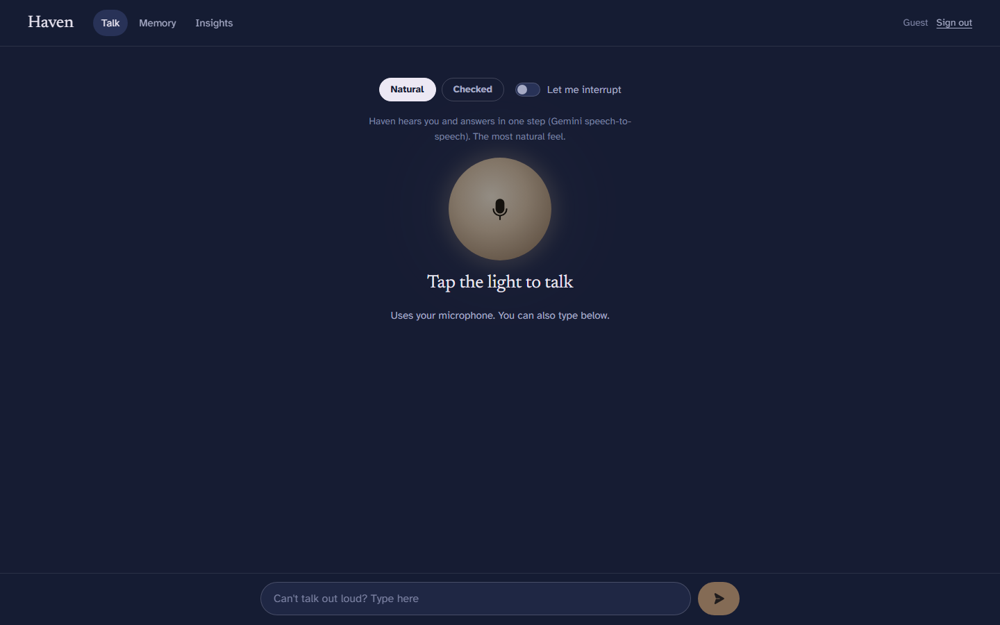
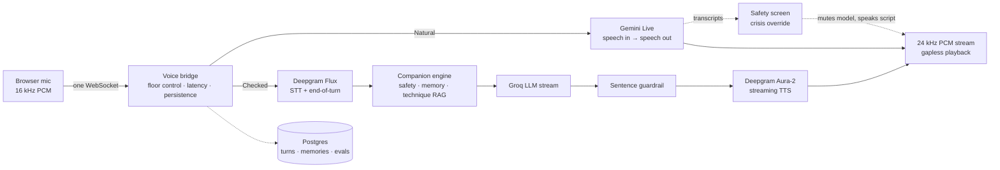
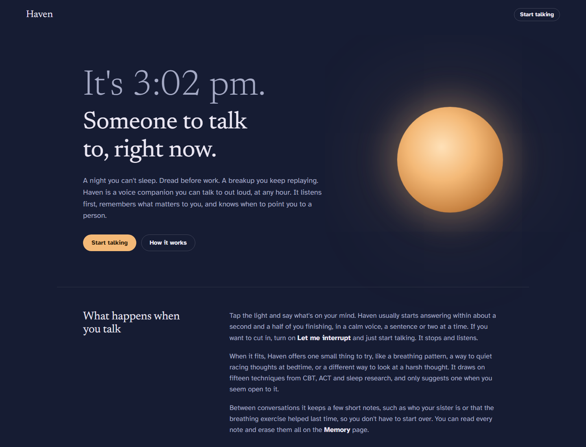

<div align="center">

# Haven

**Someone to talk to, right now.**

A real-time voice companion for the hard moments: a sleepless night, dread before work, a breakup you keep replaying.<br/>
Talk out loud, interrupt anytime, and pick up where you left off.

[**Try it live**](https://haven-frontend-w8bx.onrender.com) &nbsp;&nbsp;|&nbsp;&nbsp; [API docs](https://haven-backend-d06n.onrender.com/docs) &nbsp;&nbsp;|&nbsp;&nbsp; [Live metrics](https://haven-frontend-w8bx.onrender.com/insights)

<sub>Free hosting: the first visit after a quiet spell takes about a minute to wake up.</sub>



</div>

---

## Why this exists

Every 40 seconds someone dies by suicide, and long before that there are hundreds of smaller moments when nobody is around to talk to. Haven is built for those moments. It **listens first**, keeps short reply loops so the conversation feels like a conversation, **remembers what matters** to you between sessions, and when something sounds serious it **stops improvising** and points you to real people.

> Haven is not a therapist and not an emergency service. In the US call or text 988, in the UK and Ireland call Samaritans on 116 123, elsewhere see [findahelpline.com](https://findahelpline.com).

---

## Two voice engines, one conversation

Haven runs two complete real-time voice architectures behind the same WebSocket, and you can switch between them on the Talk screen. They make opposite trade-offs, which is the point.

| | **Natural** | **Checked** |
|---|---|---|
| How it works | Native speech-to-speech: one model hears and speaks | Streaming STT → LLM → per-sentence TTS |
| Stack | Gemini 3.1 Flash Live | Deepgram Flux → Groq `gpt-oss-120b` → Deepgram Aura-2 |
| Turn-taking | Gemini activity detection + interruption judge | Flux semantic end-of-turn + speculative replies + interruption judge |
| First audio after you stop speaking* | **1.6–1.7 s** | **1.8–2.1 s** |
| Safety | Live transcripts screened; model muted and overridden on risk | Every sentence screened *before* it is spoken |
| Best at | Prosody, tone, feeling human | Control, auditability, guarantees |

<sub>*Measured in production (Render, Frankfurt) by `tools/e2e_voice_test.py`, which streams real recorded speech over the socket like a browser does. The previous Whisper + Orpheus build took 3.0–3.7 s.</sub>



---

## The interesting parts

Each of these exists because a measurement said it should.

**Speculative replies.** Flux emits an *eager* end-of-turn about half a second before it is sure you've finished. Checked mode starts the LLM and TTS on that early signal but holds the audio. If you keep talking (`TurnResumed`), the draft is thrown away unheard. If the turn is confirmed, the audio is released instantly. In production, first audio goes out within about 50 ms of the turn being confirmed.

**Retrieval while you're still talking.** Looking up a fitting coping technique costs an embedding round trip (616 ms, measured). Haven runs it on the *partial* transcript as you speak, so by the time you finish, planning takes about 1 ms.

**No lost words on a pause.** If the turn closes on a breath ("Honestly, …") and you keep going before any reply is audible, the half-sentence is carried into your next turn instead of being answered on its own.

**An interruption judge, not a voice detector.** Plain voice-activity barge-in stops for every cough, every "mm-hmm", and Haven's own voice leaking from laptop speakers. While Haven speaks, a Flux side channel keeps transcribing the mic and a small judge decides what was meant. A backchannel ("mm-hmm", "yeah", "genau") lets Haven keep talking. Words that match what Haven just said are treated as echo and ignored. A stop phrase ("wait", "sorry", "warte") or three or more real words stops it. In Natural mode, Gemini hears silence while it speaks, and on a real interruption it is handed the buffered audio, so your first words aren't lost. Measured with real speech: "mm-hmm" ignored, "wait, sorry…" stops Haven **0.84–0.97 s** after you start talking. Inspired by [Cue](https://github.com/ioteverythin/cue), whose weights aren't public.

**Barge-in that respects what you heard.** Only the sentences actually delivered are written to history, so the model's memory of the conversation matches yours. Every reply carries a turn id, so a stale "finished playing" event can never reopen the mic in the middle of the next turn.

**A deterministic crisis path.** Crisis language never reaches the LLM in Checked mode. A fixed response with helplines is spoken, and it plays from cache in about 0.85 s. In Natural mode, the model's live transcripts are screened as they arrive: on risk, the model is muted for the rest of its turn, the client flushes its audio, and the same script is spoken in a separate voice.

**Measure, don't assume.** The technique catalog went into Gemini's instructions instead of a tool call, because the tool round trip added about 0.8 s before the first word. Flux thresholds were tuned on real phrases: the defaults took 2.4 s to close a plain statement, the most aggressive setting closed turns mid-breath, and the middle setting shipped.

---

## What else is inside

- **Wins you'd otherwise skip past.** Many high achievers stop feeling their wins: target hit, deal closed, nothing. Haven notices achievements you mention, even ones you brush off, keeps them, and brings them back when it fits. They're all on the Journey page.
- **A takeaway when you hang up.** One sentence on what you talked through, how your mood moved ("came in drained, leaving lighter"), and one small step you can take by tomorrow.
- **It follows up.** Come back and Haven opens with what you were facing ("How did the pitch go?"), not a generic hello.
- **English and German.** Both engines, with German crisis detection and German helplines (TelefonSeelsorge, 112). For German, Natural mode is recommended; Checked mode's multilingual recognizer occasionally mishears words, so it's marked beta.
- **Long-term memory.** After each turn, an LLM extracts at most two durable facts ("has a job interview Friday", "breathing exercises helped"). They shape future conversations and are fully visible and erasable on the Memory page.
- **Technique knowledge base.** 15 evidence-based techniques (CBT reframing, ACT defusion, box breathing, 5-4-3-2-1 grounding, sleep wind-down, behavioural activation and more), offered one step at a time and only when the person seems open to it.
- **Two-sided safety.** Input is screened into three tiers (none, elevated, crisis), with negation handling ("I'd never hurt myself" is elevated, not crisis). Output is screened so the model never diagnoses, never doses medication, and never claims to be a clinician.
- **Evaluation loop.** Every turn is stored with its latency breakdown and risk tier. An LLM judge scores replies on empathy, safety, helpfulness and how they sound spoken aloud. The weakest production turns are promoted into a regression suite (`17/17` passing, in English and German), which gates prompt changes.
- **Live insights.** The [Insights page](https://haven-frontend-w8bx.onrender.com/insights) shows response-time percentiles per engine, safety-tier counts and judge scores, all computed from stored turns.
- **Text fallback.** Same engine over REST for when you can't talk out loud.



---

## Stack

| Layer | Choice |
| --- | --- |
| Speech-to-speech | Gemini 3.1 Flash Live (`google-genai`) |
| Streaming STT and turn detection | Deepgram Flux |
| LLM | Groq `gpt-oss-120b`, Gemini fallback via LiteLLM |
| Streaming TTS | Deepgram Aura-2 (HTTP streaming on a pooled, pre-warmed connection) |
| Retrieval | Gemini embeddings, in-memory cosine |
| Backend | FastAPI, one WebSocket per conversation, fully async |
| Storage | PostgreSQL (turns, memories, evals), Redis (conversation window) |
| Frontend | Next.js, Web Audio (16 kHz capture, gapless 24 kHz playback) |
| Hosting | Render (Docker), all on free tiers |

---

## Run it locally

You need Python 3.11+, [uv](https://docs.astral.sh/uv/), Node 18+, and three free API keys: [Gemini](https://aistudio.google.com/apikey), [Deepgram](https://console.deepgram.com) ($200 sign-up credit) and [Groq](https://console.groq.com).

```bash
# Backend
cd backend
cp .env.example .env    # add GEMINI_API_KEY, DEEPGRAM_API_KEY, GROQ_API_KEY
uv sync
DATABASE_URL=sqlite+aiosqlite:///local_dev.db uv run uvicorn app.main:app --port 8000

# Frontend
cd frontend
cp .env.example .env.local    # NEXT_PUBLIC_BACKEND_URL=http://localhost:8000
npm install && npm run dev
```

Open http://localhost:3000, go to **Talk**, and tap the light.

## Test it

```bash
cd backend
uv run pytest                                  # 78 tests, no network: both engines, the interruption judge, safety
uv run ruff check app tests scripts && uv run pyright app scripts
uv run python -m scripts.evaluate cases        # 17 red-team and behaviour cases against the live LLM
python ../tools/e2e_voice_test.py en de        # real speech: both engines, both languages, barge-in, takeaway
```

## Deploy

`render.yaml` provisions Postgres, Redis, the backend and the frontend. Set `GEMINI_API_KEY`, `DEEPGRAM_API_KEY` and `GROQ_API_KEY` on the backend. Tables are created on boot.

To check a deployment: `/health` shows provider and database status, `/api/v1/voice/selftest` runs a TTS→STT round trip and a Gemini Live reply, and `/api/v1/voice/events` streams recent pipeline events, including every Flux turn decision with its timing.

## Project map

```
backend/app/
  voice/        bridge.py (shared protocol, streaming TTS), barge.py (interruption judge),
                live_session.py, pipeline_session.py, deepgram.py
  services/     companion engine, safety (EN/DE), knowledge (RAG), memory + wins, takeaway, LLM gateway
  api/          voice WebSocket, chat, memory, journey, insights, diagnostics
backend/scripts/evaluate.py   LLM judge + regression suite
frontend/app/                 landing, talk, journey, memory, insights
tools/e2e_voice_test.py       browser-equivalent voice test for both engines
```

## What's next

- **Under one second.** Tuned activity detection in Natural mode, and a regional deployment closer to users.
- **A learned risk classifier** running alongside the deterministic screen, trained on judged and clinician-reviewed turns.
- **Identity.** JWT verification on REST and the WebSocket handshake. The backend currently trusts the client's user id.
- **Acoustic interruption model.** Swap the transcript-based judge for an acoustic one (like Cue) once weights are available, to react before the first word is transcribed.
- **Clinical review** of the technique wording and the crisis script before any real-world use.

<div align="center">
<sub>Built by <a href="https://github.com/NoumanZahid-85">Nouman Zahid</a></sub>
</div>
