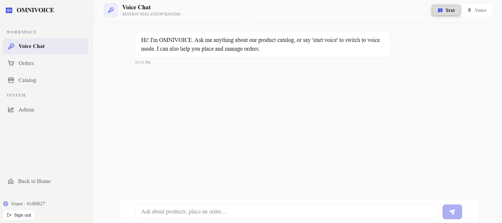
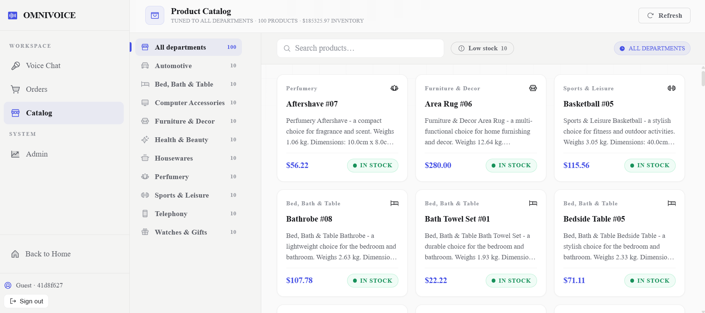
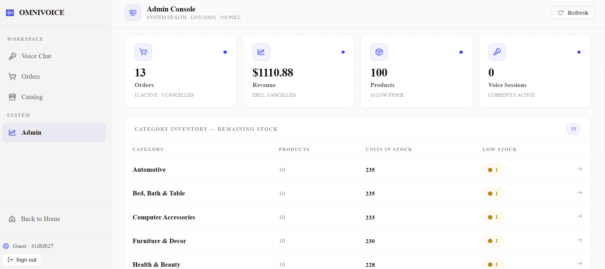
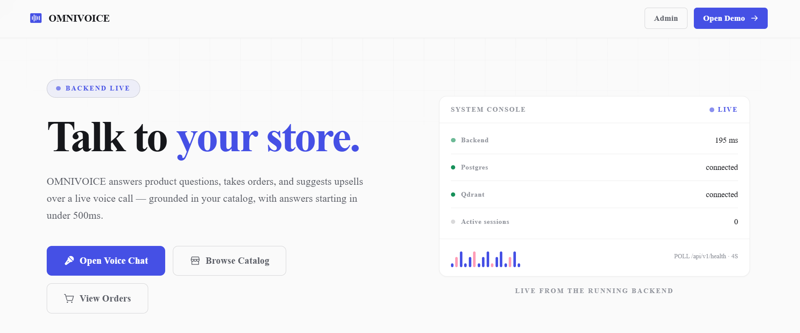
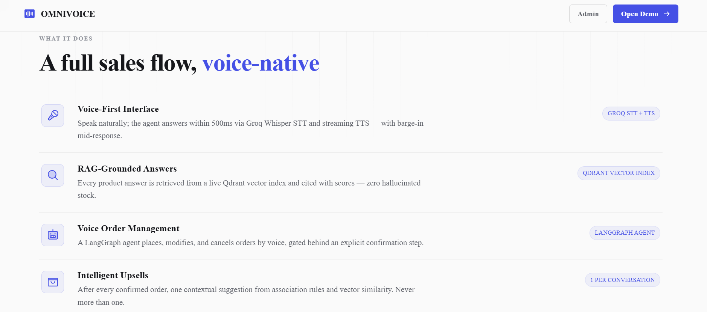
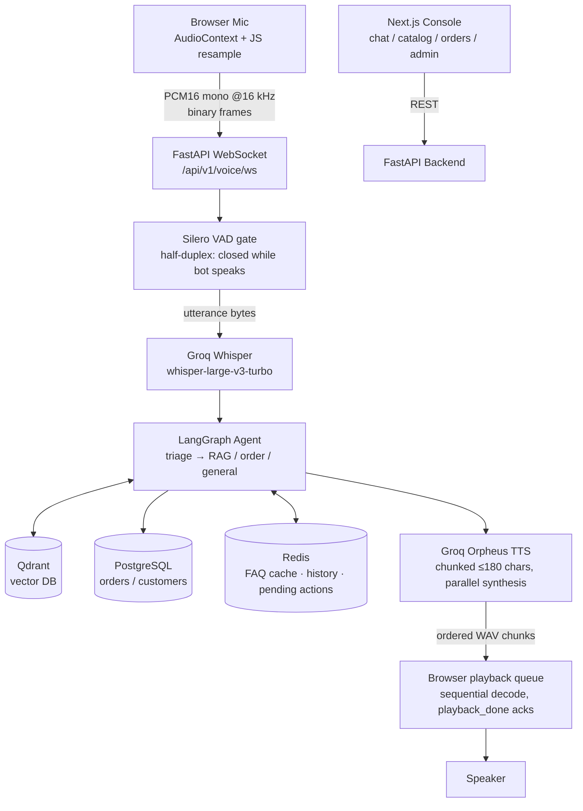

# OmniVoice AI — Voice-Enabled E-Commerce Sales Agent

<p align="center">
  <strong>A production-grade voice chatbot that lets customers browse products, ask questions, and place orders — all by speaking naturally.</strong>
</p>

<p align="center">
  <a href="./backend"></a>
  <a href="./frontend"></a>
  <a href="./render.yaml"></a>
  <a href="https://github.com/NoumanZahid-85/voicesell-ai/actions"></a>
</p>

---

## What Is This?

OmniVoice AI (internally called VoiceSell) is a complete voice-first commerce agent built from the ground up. A customer opens the web app, clicks a button, and can start talking — asking things like _"What headphones do you have under $50?"_ or _"Place me an order for 2 keyboards."_ The bot responds in a natural spoken voice within roughly half a second.

Under the hood it runs a pure-WebSocket audio pipeline: the browser streams raw PCM audio, the server transcribes it with Groq Whisper, runs a LangGraph agent that searches a Qdrant vector database for product context, generates a response with an LLM, synthesizes speech with Orpheus TTS, and streams the WAV back to the browser. No heavyweight media server, no third-party call platform — just a WebSocket and a well-designed pipeline.

---

## The Problems This Solves

| Problem                                        | Why It Matters                                            | How It's Addressed                                                               |
| ---------------------------------------------- | --------------------------------------------------------- | -------------------------------------------------------------------------------- |
| Text chatbots feel slow and robotic            | Customers abandon text chat for complex product questions | Pure-WebSocket voice pipeline with ~500ms end-to-end latency                     |
| LLMs hallucinate product specs and prices      | Customer gets wrong info, trust breaks                    | RAG-grounded answers from Qdrant; every claim is cited from the actual catalog   |
| Agents place orders without confirmation       | Destructive actions are dangerous in production           | LangGraph confirmation gate — the agent always asks before executing             |
| All visitors share one "demo customer"         | Everyone sees each other's order history                  | Per-user isolation via Supabase auth or per-browser guest UUID                   |
| WebRTC media servers are expensive and fragile | Hard to deploy on free tiers, hard to debug silently      | Dropped WebRTC entirely; replaced with a simple WebSocket + browser AudioContext |

---

## Screenshots

### Chat Interface



The main customer-facing interface. Supports both text and voice mode. The session ID is tracked in the header, and the left sidebar shows navigation between Voice Chat, Orders, Catalog, and Admin sections.

### Product Catalog



Browse the full Olist product catalog with category filtering, pricing, and stock status. The catalog is backed by the same data that powers the RAG retrieval — so what the bot says and what the catalog shows are always consistent.

### Admin Dashboard



The admin panel shows real-time order volumes, inventory status, and system health metrics. Only accessible to users with the admin role.

### Order Management Dashboard



Customer-facing order history view with status tracking (pending → confirmed → shipped → delivered → cancelled), itemized breakdowns, and timestamps.

### Feature Overview



---

## System Architecture

### Chat (Text) Architecture


The text chat path uses a standard REST flow. A message hits the FastAPI `/api/v1/chat` endpoint, gets routed through the LangGraph ReAct agent (`triage → rag → respond`), and the response is returned. Redis provides FAQ caching (cache hit = no LLM call) and sliding-window conversation memory. Qdrant handles vector search for product Q&A, PostgreSQL handles order reads/writes.

### Voice Architecture


The voice path replaces the REST call with a persistent WebSocket. The browser records mic audio using the Web Audio API, resamples it to 16 kHz PCM, and streams binary frames to the server. The server runs Silero VAD to detect when the user has stopped speaking, batches the utterance, sends it to Groq Whisper for transcription, feeds the transcript to the same LangGraph agent, then pipelines the response through Groq Orpheus TTS in ~180-character chunks. Each chunk is a complete WAV sent back over the WebSocket in strict order. The browser queues and plays them sequentially.

### Voice Pipeline (Detailed Flow)



---

## WebSocket Protocol

| Direction       | Payload                                                            | Meaning                                                                          |
| --------------- | ------------------------------------------------------------------ | -------------------------------------------------------------------------------- |
| Client → Server | `binary`                                                           | Raw PCM16 mono, 16 kHz, ~32 ms frames                                            |
| Client → Server | `JSON {"type":"playback_done"}`                                    | All queued reply chunks finished playing                                         |
| Server → Client | `JSON ready / transcript / agent_caption / speaking_start / error` | Session lifecycle + captions                                                     |
| Server → Client | `binary`                                                           | One complete WAV (Orpheus 24 kHz mono) per text chunk, delivered in strict order |

Turn-taking constants (start/end confidence thresholds, 1.5 s silence-to-end, 20 s max utterance, LLM timeout, watchdog) are all tunable at the top of [`backend/app/voice/ws_session.py`](./backend/app/voice/ws_session.py).

---

## Tech Stack

| Layer                        | Technology                                       | Why This, Not Something Else                                                                              |
| ---------------------------- | ------------------------------------------------ | --------------------------------------------------------------------------------------------------------- |
| **Voice Transport**          | WebSocket + Web Audio API                        | Dropped Daily/WebRTC — simpler to deploy, simpler to debug, no media server cost                          |
| **Speech-to-text**           | Groq Whisper (`whisper-large-v3-turbo`)          | Fast enough for real-time, handles accents well, free API tier                                            |
| **Text-to-speech**           | Groq Orpheus TTS                                 | State-of-the-art naturalness, no separate API bill                                                        |
| **LLM**                      | Groq `llama-3.3-70b` (primary) + Gemini fallback | Sub-100ms TTFT on Groq; Gemini as backup                                                                  |
| **Agent framework**          | LangGraph                                        | Explicit state machine, human-in-the-loop hooks, checkpointing — none of this exists in vanilla LangChain |
| **Voice Activity Detection** | Silero VAD (server-side)                         | Process-level; no external API call; deterministic silence detection                                      |
| **Vector database**          | Qdrant Cloud                                     | Rust-based, sub-5ms queries, free cloud tier, rich metadata filtering                                     |
| **Relational DB**            | PostgreSQL via Supabase                          | MVCC row locking for concurrent order writes — SQLite would deadlock                                      |
| **Cache / Memory**           | Redis (Upstash)                                  | Sub-ms FAQ cache lookups, sliding-window conversation history                                             |
| **Backend framework**        | FastAPI + `asyncpg`                              | Native async, matches the event loop the voice WebSocket lives on                                         |
| **Frontend**                 | Next.js 15 (App Router)                          | Production-grade React, SSR, proper routing for admin panel complexity                                    |
| **Auth**                     | Supabase Auth                                    | Already using Supabase for DB; shared JWT, guest mode with localStorage UUID                              |
| **Package manager**          | `uv`                                             | 10–100× faster than pip, deterministic lockfile                                                           |
| **Deployment**               | Render Blueprint                                 | One `render.yaml` provisions Postgres, Redis, backend, and frontend                                       |

---

## Key Design Decisions

### Half-Duplex by Construction

While the bot is speaking, the server-side VAD gate is closed. Even if the client keeps streaming mic audio, the server discards it. This prevents echo from being transcribed and completely eliminates barge-in artifacts without any hardware echo cancellation.

### No Daily, No Pipecat

The original plan used Pipecat + Daily WebRTC. After running into consistent audio sample-rate mismatches and deployment complexity on the free tier, I dropped both and replaced the entire transport layer with a plain WebSocket. The browser handles mic capture and PCM resampling natively via the Web Audio API. This saved significant infrastructure complexity and made local dev trivially easy.

### RAG Grounding

Every product-related answer is pulled from Qdrant vectors (Gemini text-embedding-004 at 768 dims). The LLM is explicitly instructed to say "I don't have information on that" if the retrieved context doesn't contain the answer. Hallucinated prices and specs are architecturally impossible for catalog queries.

### Confirmation Gate for Orders

The LangGraph graph has an explicit `confirmation_gate` node. When the agent decides to place, modify, or cancel an order, it pauses and presents the details to the user ("I'll place 3 keyboards for $45 total — shall I confirm?"). The order write only happens after receiving an explicit affirmative. A Redis key tracks the pending action to prevent any other utterance from being interpreted as a confirmation.

### Per-User Order Isolation

Every order row is scoped to a `customer_id`. Authenticated users get their Supabase UUID; unauthenticated users get a random UUID stored in `localStorage`. Two different browser windows — even two incognito tabs — see completely different order histories.

---

## Repository Structure

```
voicesell/
├── backend/
│   └── app/
│       ├── api/              # FastAPI route modules (chat, voice WS, orders, catalog)
│       ├── core/             # Config (pydantic-settings), logging
│       ├── db/               # SQLAlchemy async models, session lifecycle
│       ├── schemas/          # Pydantic request/response schemas
│       ├── services/         # RAG, LangGraph agent, order service, recommendations, cache
│       └── voice/            # ws_session.py — the VAD→STT→agent→TTS pipeline
├── frontend/
│   ├── app/                  # Next.js App Router (landing, chat, catalog, orders, admin)
│   ├── components/
│   │   ├── auth.tsx          # Supabase login gate + "Continue as Guest" button
│   │   └── voice/            # VoiceSession component, waveform visualization
│   └── lib/                  # API client, Supabase client singleton
├── tools/
│   ├── e2e_voice_test.py     # End-to-end voice harness (simulates browser, places real orders)
│   ├── test_isolation.py     # Proves two guest sessions never share order history
│   └── purge_faq_cache.py    # Ops helper: invalidate stale Redis FAQ cache entries
├── docs/
│   └── adr/                  # Architectural Decision Records (ADR-001 through ADR-003)
├── Images/                   # Screenshots and architecture diagrams
└── render.yaml               # Render Blueprint: Postgres + Redis + backend + frontend
```

---

## Local Development

**Prerequisites:** Python 3.11+, Node.js 18+, Docker (for Postgres and Qdrant locally).

```bash
# 1. Spin up local infrastructure
docker compose up -d postgres qdrant

# 2. Start the backend
cd backend
cp .env.example .env        # fill in GROQ_API_KEY, GEMINI_API_KEY, QDRANT_URL, etc.
uv run python -m scripts.ingest_olist   # ingest Olist catalog into Postgres + embed into Qdrant
uv run uvicorn app.main:app --reload --port 8000

# 3. Start the frontend (new terminal)
cd frontend
cp .env.example .env.local  # optional: add NEXT_PUBLIC_SUPABASE_* for login
npm install
npm run dev
```

Open [http://localhost:3000](http://localhost:3000). The backend health check is at [http://localhost:8000/health](http://localhost:8000/health).

### Running Tests

```bash
cd backend

# Unit + integration tests
uv run pytest

# Static analysis
uv run pyright app/
uv run ruff check app/ tests/

# Full end-to-end voice test (synthesizes speech, streams it like a real browser, asserts the order goes through)
python tools/e2e_voice_test.py $GROQ_API_KEY

# Run against the production deployment instead
E2E_WS_URL=wss://voicesell-backend.onrender.com/api/v1/voice/ws?session_id=e2e \
  python tools/e2e_voice_test.py $GROQ_API_KEY

# Prove order isolation between two guest sessions
python tools/test_isolation.py
```

The `e2e_voice_test.py` harness fully simulates a browser session: it connects to the WebSocket, receives the greeting WAV, synthesizes spoken questions using Groq TTS, resamples them to 16 kHz PCM, and streams binary frames exactly the way the browser does. It asserts that the greeting plays → the utterance is transcribed correctly → a product quote is returned → a confirmation places a **real order** that appears in the database. If this passes against production, the microphone in your browser is not the variable anymore.

---

## Deploying to Render

The repo ships a [`render.yaml`](./render.yaml) Blueprint that provisions four linked services in one click: PostgreSQL, Redis (Key Value), the Python backend, and the Next.js frontend.

### Steps

1. Push the repository to GitHub (`master` branch).
2. In Render: **New → Blueprint** → select the repo → **Apply**.
3. Fill in the secrets marked `sync: false` in the dashboard:
   - **Backend:** `QDRANT_URL`, `QDRANT_API_KEY`, `GROQ_API_KEY`, `GEMINI_API_KEY`, `SUPABASE_URL`, `SUPABASE_KEY`
   - **Frontend:** `NEXT_PUBLIC_SUPABASE_URL`, `NEXT_PUBLIC_SUPABASE_ANON_KEY` (optional — omit for guest-only mode)
4. Redeploy after saving.

> **Free-tier note:** Embeddings use the Gemini API instead of a local sentence-transformer model, keeping the backend within Render's free-tier memory limit (~512 MB). Expect a few seconds of thinking time on order turns — the pipeline handles this with a 60 s LLM timeout and a spoken fallback phrase if the model takes too long.

### Auto-Seeding

On first boot, the backend checks if the `products` table is empty and, if so, ingests the Olist catalog and embeds all products into Qdrant before serving traffic. Disable with `AUTO_SEED=false`. If Qdrant isn't configured at seed time, Postgres still populates (catalog browsing works) and only voice/chat search needs the Qdrant keys added later.

### Production Debugging

Without log access, use these two endpoints immediately after a test call:

- `GET /health` — returns DB and Qdrant connectivity status.
- `GET /api/v1/voice/events` — in-memory ring of the last ~50 session events (`vad_probe conf=… kb=…`, `stt`, `tts_chunk`, `tts_fail`, `turn_error`). This is the fastest way to diagnose a silent failure in the voice pipeline.

---

## Authentication & Order Isolation

| Mode                       | Identity Source                           | Behaviour                                                           |
| -------------------------- | ----------------------------------------- | ------------------------------------------------------------------- |
| **Signed in**              | Supabase Auth UUID (email/password login) | Persistent across devices, full order history                       |
| **Guest (developer mode)** | Random UUID in `localStorage`             | Per-browser; a fresh incognito window gets its own isolated history |

This eliminates the classic demo bug where all visitors shared one hardcoded customer row. Two guest windows have provably disjoint order histories — verified by `tools/test_isolation.py`.

### Enabling Supabase Login

The app degrades gracefully: without Supabase env vars, it runs guest-only (no login screen). To enable real accounts:

1. [supabase.com/dashboard](https://supabase.com/dashboard) → **Authentication → Providers → Email**: ensure Email is **enabled**.
2. **Authentication → Sign In / Up**: turn off "Confirm email" for frictionless demos.
3. **Project Settings → API**: copy the **Project URL** and **anon public** key. ⚠️ Never use the `service_role` key in the browser.
4. Set `NEXT_PUBLIC_SUPABASE_URL` and `NEXT_PUBLIC_SUPABASE_ANON_KEY` in `frontend/.env.local` (or on Render).
5. Redeploy. The login gate appears; "Continue as Guest" stays available.

No SQL migrations needed for auth itself — the backend auto-creates a `customers` row for any identity that places an order.

---

## Known Limitations

- **Bare catalog queries under-retrieve.** Phrases like _"What products do you have?"_ give the keyword extractor nothing to work with. More specific queries like _"Show me sports equipment"_ or _"Do you have laptops?"_ work correctly.
- **No server-side JWT verification.** The backend trusts the `customer_id` supplied by the client. Fine for a demo; hardening would mean verifying the Supabase JWT on each API request.
- **Half-duplex by design.** You cannot interrupt the bot mid-sentence. The VAD gate is closed while audio is playing.
- **Free-tier latency.** Order turns involve two chained LLM calls (triage + execution). On a cold Render instance expect 3–5 seconds; on a warm instance, ~1–2 seconds.

---

## Architectural Decision Records

The `docs/adr/` folder contains the reasoning behind the three biggest architectural choices made during the project:

- **ADR-001:** Why LangGraph over raw LangChain AgentExecutor (explicit state machine, human-in-the-loop, checkpointing).
- **ADR-002:** Why Qdrant over ChromaDB or Pinecone (Rust engine, 5ms P99, free cloud tier, no vendor lock-in).
- **ADR-003:** Why a plain WebSocket over Pipecat + Daily WebRTC (no media server, no sample-rate mismatch, trivial local dev).
