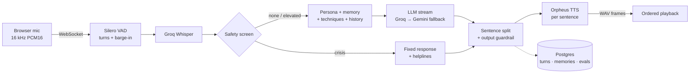

# Haven

**A real-time voice companion for mental wellbeing.** Someone to talk to at 2:37 in the morning.

Haven is a voice-first AI companion for everyday hard moments: a sleepless night, anxiety before work, a breakup. Tap once and talk. It replies in a natural voice, can be interrupted, remembers what matters across conversations, and routes people in crisis to human help.

> Haven is not a therapist or an emergency service.

---

## Features

- **Real-time voice.** One WebSocket carries the audio: Silero VAD → Whisper STT → streaming LLM → per-sentence TTS → ordered playback.
- **Streaming responses.** The first sentence is synthesized while the LLM is still generating the rest.
- **Barge-in.** Optional full-duplex mode: speak over Haven and it stops, then listens.
- **Safety on both sides of the model.** Crisis language bypasses the LLM for a fixed response with helplines. Every spoken sentence is screened before TTS.
- **Long-term memory.** Durable facts persist across sessions. Users can view all of them and erase them.
- **Technique retrieval (RAG).** 15 evidence-based techniques (CBT, ACT, breathing, grounding, sleep) are offered only when relevant.
- **Evaluation loop.** Per-turn latency telemetry, LLM-as-judge scoring, and a regression suite built from the weakest turns.

## Architecture



| Layer | Technology |
| --- | --- |
| Voice transport | WebSocket + Web Audio API |
| Turn detection | Silero VAD (ONNX) |
| Speech-to-text | Groq Whisper `large-v3-turbo` |
| LLM | Groq `gpt-oss-120b`, Gemini fallback via LiteLLM |
| Text-to-speech | Groq Orpheus |
| Retrieval | Gemini embeddings, in-memory cosine |
| Storage | PostgreSQL (turns, memories, evals), Redis (conversation window) |
| Backend / Frontend | FastAPI · Next.js |
| Hosting | Render (Docker) |

## Performance

These were measured end to end with real audio using `tools/e2e_voice_test.py`, on Groq's free tier.

| Stage | Latency |
| --- | --- |
| Speech-to-text | 330–430 ms |
| LLM first token | 370–730 ms |
| First audio, normal turn | 1.9–2.6 s |
| First audio, crisis turn (cached) | 0.35–0.43 s |

The regression suite passes 14 of 14 cases, covering crisis routing, negation, medication and diagnosis requests, and prompt injection. Live p50/p95 per stage are on the **Insights** page.

## Key design decisions

- **The crisis path is deterministic.** The highest-stakes turn never depends on sampling, provider uptime, or prompt injection.
- **Guardrails run per sentence.** Because replies stream into speech, each sentence is checked before it is spoken, not after.
- **Half-duplex is the default.** Echo cannot be transcribed by construction. Barge-in is opt-in, uses stricter VAD thresholds, and every reply carries a turn ID so stale events never reopen the mic.
- **History records what was heard.** After an interruption, only the sentences actually delivered are stored.
- **RAG runs in memory.** A small curated corpus doesn't need a vector database on the latency path.

## Getting started

Requirements: Python 3.11+, [uv](https://docs.astral.sh/uv/), Node 18+, and a [Groq API key](https://console.groq.com).

```bash
# Backend
cd backend
cp .env.example .env          # set GROQ_API_KEY (GEMINI_API_KEY optional)
uv sync
DATABASE_URL=sqlite+aiosqlite:///local_dev.db uv run uvicorn app.main:app --port 8000

# Frontend
cd frontend
cp .env.example .env.local    # NEXT_PUBLIC_BACKEND_URL=http://localhost:8000
npm install && npm run dev
```

Open http://localhost:3000 and go to **Talk**.

## Testing

```bash
cd backend
uv run pytest                                   # 41 tests, no network
uv run ruff check app tests scripts
uv run python -m scripts.evaluate cases         # regression suite (live LLM)
python ../tools/e2e_voice_test.py $GROQ_API_KEY # full voice pipeline, real audio
```

## API

| Endpoint | Purpose |
| --- | --- |
| `WS /api/v1/voice/ws` | Voice session (`session_id`, `user_id`, `barge_in`) |
| `POST /api/v1/chat` | Text conversation, same engine |
| `GET/DELETE /api/v1/memory/{user_id}` | View or erase long-term memory |
| `GET /api/v1/insights` | Volume, latency percentiles, safety tiers, eval scores |
| `GET /api/v1/voice/selftest` | Server-side TTS → STT round trip |
| `GET /health` | Database and provider status |

## Deployment

`render.yaml` provisions Postgres, Redis, the backend, and the frontend. Set `GROQ_API_KEY` and `GEMINI_API_KEY` on the backend. Tables are created on startup.

## Project structure

```
backend/app/
  api/        voice WebSocket, chat, memory, insights, health
  services/   companion engine, safety, knowledge (RAG), memory, LLM gateway
  voice/      VAD state machine, streaming TTS, barge-in
  db/         models: memories, turns, turn_evals
backend/scripts/evaluate.py   LLM judge + regression suite
frontend/app/                 landing, talk, memory, insights
tools/e2e_voice_test.py       browser-equivalent voice test
```

## Roadmap

- Streaming TTS to bring first audio under 1 s
- Fine-tuned risk classifier alongside the deterministic screen
- JWT verification on REST and WebSocket requests
- Server-side echo cancellation for barge-in on laptop speakers
- Clinical review of the technique wording and crisis script
